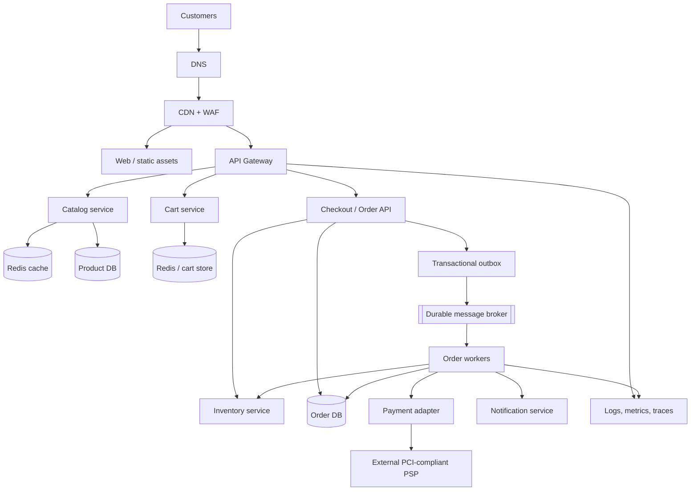

# Retail E-commerce for Peak Sales

A cloud-agnostic reference architecture for an e-commerce platform designed to absorb **10× sale-day traffic spikes** while protecting order integrity.

> **Status:** Architecture reference and learning project. It documents a production-minded design, not a turnkey deployment. Validate cloud resources, payment-provider contracts, SLOs, capacity limits, and compliance scope for any real workload.

## Goals

- Serve browse traffic efficiently through CDN and caching.
- Keep checkout responsive during sudden demand spikes.
- Accept orders durably and process them asynchronously.
- Prevent duplicate orders and duplicate payment side effects.
- Reserve inventory safely under contention.
- Reduce PCI DSS scope with a PCI-compliant provider's hosted payment fields/redirect and tokenisation.
- Scale stateless services and workers independently.
- Demonstrate repeatable load, resilience, and operational testing.

## Architecture at a glance

See [detailed diagrams](architecture/diagrams.md) and the [learning guide](docs/learning-guide.md).

## Repository map

- `architecture/diagrams.md` — system context, service architecture, order sequence, deployment and recovery diagrams
- `architecture/cloud-mapping.md` — AWS, Azure and Google Cloud service equivalents
- `architecture/decisions/` — architecture decision records and trade-offs
- `docs/` — learning guide, order lifecycle, reliability, security, scaling and operations
- `api/openapi.yaml` — starter API contract
- `load-tests/peak-sale.js` — k6 traffic scenario

## Core order flow

1. Static assets and cacheable catalog reads are served from edge/application caches where safe.
2. Dynamic requests pass through WAF, API gateway, authentication and rate limits.
3. Checkout validates the cart and performs an atomic inventory reservation with expiry.
4. The Order API writes an order in `PENDING_PAYMENT` plus an outbox record in one database transaction.
5. An outbox publisher forwards the event to a durable broker. The API returns an order reference without waiting for email or fulfilment.
6. A worker consumes the event and calls the payment provider with a stable idempotency key.
7. Success transitions the order to `CONFIRMED`; a definitive decline transitions to `PAYMENT_FAILED` and releases stock. Ambiguous timeouts are reconciled before retrying side effects.
8. Consumers are idempotent. Bounded exponential retries and a dead-letter queue handle poison messages.

## Multi-cloud mapping

| Capability | AWS | Azure | Google Cloud |
|---|---|---|---|
| CDN / edge | CloudFront | Azure Front Door | Cloud CDN |
| WAF | AWS WAF | Azure WAF | Cloud Armor |
| API management | API Gateway | API Management | API Gateway / Apigee |
| Containers | ECS / EKS | AKS / Container Apps | GKE / Cloud Run |
| Cache | ElastiCache | Azure Managed Redis | Memorystore |
| Queue / events | SQS / SNS / EventBridge | Service Bus / Event Grid | Pub/Sub |
| Relational DB | Aurora / RDS | Azure Database for PostgreSQL | Cloud SQL / AlloyDB |
| Object storage | S3 | Blob Storage | Cloud Storage |
| Secrets / keys | Secrets Manager / KMS | Key Vault | Secret Manager / Cloud KMS |
| Observability | CloudWatch / X-Ray | Azure Monitor / App Insights | Cloud Monitoring / Trace |

Choose one provider for a deployment. This is a translation guide, not a recommendation to run active-active across all three clouds.

## Validation roadmap

1. Implement checkout → order DB + outbox → broker → worker.
2. Add atomic inventory reservation and compensation.
3. Integrate a payment-provider sandbox with idempotency.
4. Add catalog caching and invalidation.
5. Containerise and deploy to one cloud.
6. Add dashboards, alerts, autoscaling and failure injection.
7. Run baseline, 2×, 5× and 10× load tests; tune from measured bottlenecks.

## Design guarantees

- **No silent order loss:** order state and outbox event commit atomically.
- **At-least-once delivery, effectively-once business effects:** consumers handle duplicates.
- **No blind payment retries:** provider idempotency and reconciliation handle ambiguous outcomes.
- **Inventory is authoritative:** cache is never the stock source of truth.
- **Backpressure beats overload:** bounded queues, admission control and graceful degradation protect critical paths.
- **Observability is part of the design:** queue age, order transitions, payment outcomes and reconciliation lag are first-class signals.

## License

Apache-2.0.
