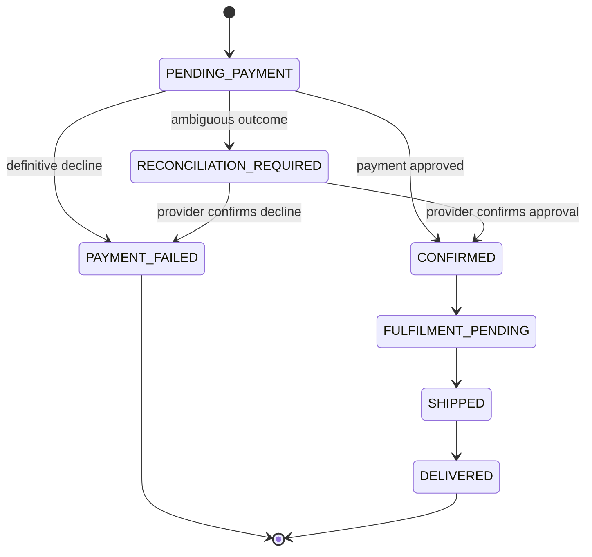

# Order lifecycle

A suggested order state machine:

The order and outbox event are committed in one database transaction. Inventory reservation is an explicit operation with an expiry. Payment authorization uses a stable idempotency key derived from the order/payment attempt. Unknown provider outcomes enter reconciliation rather than an unsafe blind retry.
